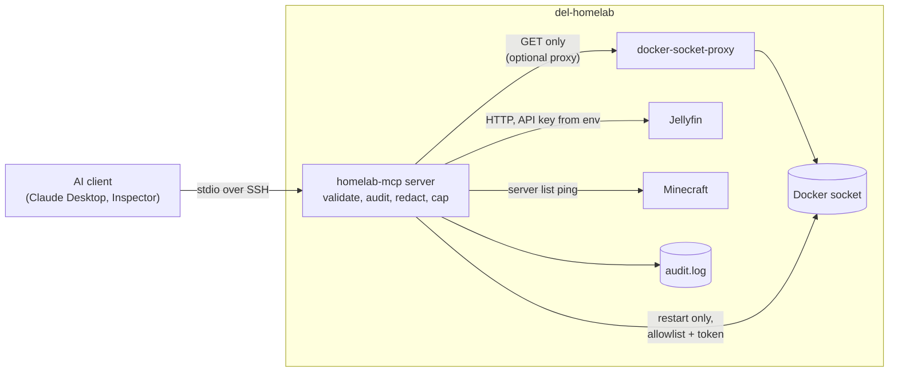

# homelab-mcp

An MCP server that lets an AI client (Claude Desktop or any MCP client) check
on a home server: container status, logs, disk, Jellyfin and Minecraft.
Read-only by default; anything that changes state is gated.

Status: **Phase 5** (complete: tools, audit log, gated restart, threat model, demo). Built on the
official Python SDK, `mcp` 2.x (`MCPServer`, not the 1.x `FastMCP`).

## Run it

```bash
python -m venv .venv
.venv/Scripts/activate          # Linux: source .venv/bin/activate
pip install -e . pytest
pytest
npx @modelcontextprotocol/inspector python -m homelab_mcp.server
```

## Tools

| Tool | Tier | Phase | Status |
|------|------|-------|--------|
| `ping`, `server_info` | read-only | 1 | done |
| `container_status` | read-only | 2 | done: name, image, state, health, uptime |
| `tail_logs(container, lines=50)` | read-only | 2 | done: name validated, max 200 lines / ~16 KB, secrets redacted, output labelled untrusted |
| `disk_usage` | read-only | 2 | done: main filesystem plus per-container size from the Docker API |
| `jellyfin_library_stats` | read-only | 3 | done: library counts and active sessions, numbers only |
| `minecraft_status` | read-only | 3 | done: server list ping, version and player counts; MOTD dropped, names filtered |
| `restart_container(container, confirm_token=None)` | **write** | 4 | done: allowlisted containers only; first call returns a 60 s single-use token and restarts nothing, second call with the token restarts; marked destructive |

## Configuration (environment variables)

| Variable | Used by | Default |
|----------|---------|---------|
| `JELLYFIN_URL` | `jellyfin_library_stats` | `http://localhost:8096` |
| `JELLYFIN_API_KEY` | `jellyfin_library_stats` | none (required) |
| `MINECRAFT_HOST`, `MINECRAFT_PORT` | `minecraft_status` | `localhost`, `25565` |
| `HOMELAB_MCP_AUDIT_LOG` | audit log | `~/.homelab-mcp/audit.log` |
| `HOMELAB_MCP_RESTART_ALLOWLIST` | `restart_container` | `jellyfin,komga,navidrome,uptime-kuma` |
| `DOCKER_HOST` | read-only Docker tools | local socket |
| `HOMELAB_MCP_DOCKER_WRITE_HOST` | `restart_container` | `docker.from_env()` |

## Phases

1. Hello-world server and one client connected (MCP Inspector)
2. Docker read-only tools
3. Jellyfin and Minecraft tools
4. Gated `restart_container` and the audit log
5. This README: architecture, threat model, prompt-injection demo (`demo/injection_demo.py`)

## Reaching the server

Start with stdio launched over SSH from the client config, which reuses
existing SSH access. HTTP transport behind Tailscale is the alternative.
Confirm SSH works with the chosen client before committing to it.

## Architecture



Every tool call passes through the audit wrapper first. Output from Docker
logs is the only free text from a third party that reaches the model, and it
is redacted, capped and labelled. Jellyfin and Minecraft tools return numbers
and filtered fields only.

## Threat model

Trust boundary: the model and everything it reads are treated as untrusted. The
human at the client, the host OS and the environment variables are trusted.

| # | Threat | Mitigation | Residual risk |
|---|--------|------------|---------------|
| 1 | **Docker socket is root on the host.** Anything that talks to it can start a privileged container. | Server only calls list, inspect, logs, df and restart. Read tools can use a GET-only proxy (`deploy/docker-socket-proxy.compose.yml`). | The restart path needs POST, and the proxy cannot allow restart while blocking container creation, so it uses the socket directly. A compromised server process is root-equivalent. |
| 2 | **Prompt injection via tool output.** Minecraft chat, app logs and similar text can contain instructions. | Log output is redacted, capped at ~16 KB and wrapped in `<untrusted_log_data>` with a warning; a forged closing tag is neutralised; tool descriptions and server instructions say output is data. Jellyfin and Minecraft tools drop titles, MOTD and chat and return numbers or validated names only. | Labels are guidance, not enforcement: a model can still be misled. The real protection is that dangerous actions are gated (row 4). |
| 3 | **Secret leakage.** Logs can contain passwords, tokens, keys. | Secrets only from environment variables. Logs are redacted (key=value, JSON, bearer, URL credentials, JWTs, known token prefixes) before truncation. Audit log redacts token/password/key/secret arguments. | Pattern based: an unusual secret format can slip through; redaction over-matches on purpose. |
| 4 | **Unwanted state change.** An injected or confused model restarts something. | One write tool. Allowlist (default jellyfin, komga, navidrome, uptime-kuma). Two steps: a 60 s single-use token bound to the container. Marked destructive so clients prompt the human. | A fully compromised model can perform both steps on an allowlisted container. The client prompt, allowlist and audit log are the backstops. |
| 5 | **Input abuse.** Shell injection, path tricks, huge outputs. | No shell; Docker SDK only. Container names must match `[a-zA-Z0-9][a-zA-Z0-9_.-]*` (max 128). Lines capped at 200, output at ~16 KB, HTTP responses at 1 MB. Host, port and URLs come from the environment, never tool input. | None known. |
| 6 | **No accountability.** | Every call is written to `audit.log` (tool, arguments, time, outcome) before it runs; if the log can't be written the call is refused. | The log is a local file; someone with the user's shell can edit it. |
| 7 | **Error leakage.** | In SDK 2.x only `ToolError` text reaches the model; unexpected exceptions show as a generic error and are logged server-side. Anticipated failures use `UserError` so the model sees why. | Config errors (e.g. missing API key) are visible only in the server log. |

## Prompt-injection demo

```bash
python demo/injection_demo.py
```

Runs offline against a fake Docker client but through a real `MCPServer`, so the
audit log is genuine. A player named Mallory puts instructions and a forged
closing tag in Minecraft chat, plus a leaked `rcon.password`. The demo shows:

1. **The attack**: the raw log.
2. **Defence 1**: what the model receives. The block is labelled as untrusted,
   the password is `[REDACTED]`, the forged tag is replaced.
3. **Defence 2**: the model obeys anyway and asks to restart `gitea`. Refused:
   not on the allowlist. Nothing restarts.
4. **Defence 3**: an allowlisted target (`jellyfin`) still needs the
   confirmation token. A made-up token is refused.
5. **The audit trail**: all attempts, including refused ones, with the token
   redacted.

## Related

- [del-homelab](https://github.com/somed-msoe/del-homelab): the homelab this server reports on.
